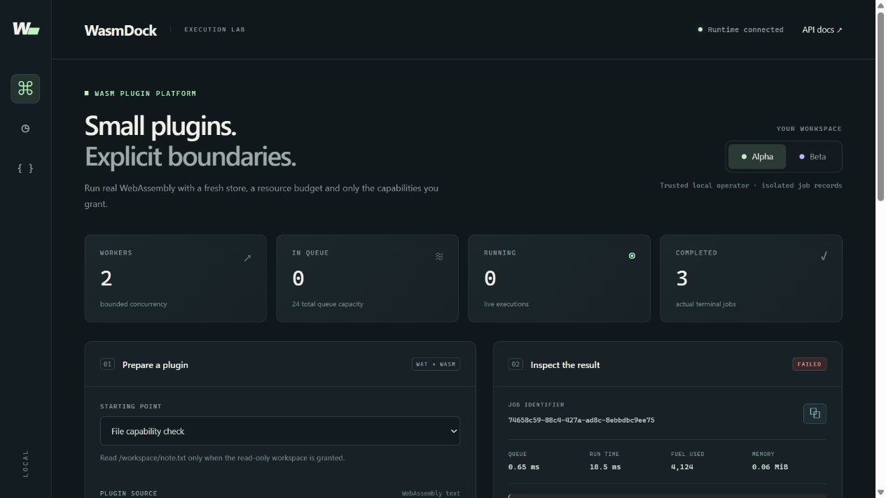

# WasmDock

**Small plugins. Explicit boundaries.**

[](https://github.com/Sanjana432/wasmdock/actions/workflows/ci.yml)


A working WebAssembly execution laboratory with a browser control plane, real WASI plugins, tenant-partitioned jobs, fair dispatch and inspectable resource limits. Submit code, watch its execution, and demonstrate exactly what happens when a plugin loops forever, requests excessive memory or tries to open an ungranted file.

The host is Python/FastAPI. The plugins execute as WebAssembly in Wasmtime; their transformations and failures are not simulated. WAT source examples compile through Wasmtime’s actual `wat2wasm` API, so a Rust toolchain is optional.



[View the mobile layout](docs/mobile.jpg).

## What you can demonstrate

- Actual stdin-to-stdout ASCII uppercase and simple CSV-column transformations inside WASI guests.
- Fresh Engine, Store and child process per job, with no inherited guest environment or filesystem.
- Instruction fuel, linear-memory limits, execution interruption and a hard child-process deadline.
- Combined stdout/stderr capture limits enforced by bounded host callbacks.
- An explicit read-only directory capability, containing only synthetic per-job data.
- Two demo tenants with isolated job queries, per-tenant admission limits and round-robin dispatch.
- Persistent job history, queue/run timings, guest fuel use, JSON downloads and a Prometheus-format metrics endpoint.

## Run locally

Use Python 3.12 on Windows, Linux or macOS. From this checkout:

```bash
python -m venv .venv
# Windows PowerShell:
.venv\Scripts\Activate.ps1
# macOS/Linux: source .venv/bin/activate
python -m pip install -e ".[test]"
python -m wasmdock serve
```

Open **http://127.0.0.1:8020**. The UI needs no build command or API key. The application’s interactive API documentation is at `/docs` and its schema is at `/openapi.json`. Swagger’s JavaScript/CSS comes from its standard CDN; the main dashboard is fully local.

Terminal-only demo:

```bash
python -m wasmdock demo
```

Optional Docker launch:

```bash
docker compose up --build
```

The Compose example binds to loopback, drops Linux capabilities and adds container CPU/memory limits. It is an additional deployment boundary; Docker is not required for the native demo.

## Three-minute interview demo

1. Run **Uppercase text** and inspect actual stdout, fuel consumed and allocated linear memory.
2. Choose **Fuel exhaustion**. An infinite guest loop traps with `fuel_exhausted`.
3. Choose **File capability check** without a workspace. The guest’s actual `path_open` call fails and it exits 77. Grant the read-only workspace and repeat; the synthetic file becomes readable.
4. Choose **Memory growth limit**. `memory.grow` returns failure under the configured Store budget; the sample reports the refusal and exits 78.
5. Select tenant alpha and queue several jobs. Switch to beta and run a healthy transformation. Inspect the per-tenant queue and outputs.
6. Export a result JSON and discuss the difference between guest runtime, process startup and queue latency.

See the [detailed walkthrough](docs/demo.md) and [architecture](docs/architecture.md).

## API examples

```bash
curl -X POST http://127.0.0.1:8020/api/jobs \
  -H "Content-Type: application/json" -H "X-Tenant: alpha" \
  -d '{"sample_id":"uppercase","stdin":"hello wasm","fuel":1000000,"memory_mb":16}'
```

Use `GET /api/jobs/{id}` with the same tenant header to poll the result. `wat` accepts custom WebAssembly Text; `wasm_base64` accepts an actual binary. Supply exactly one of `sample_id`, `wat` or `wasm_base64`. Custom modules must export `_start` with no parameters/results, may import only WASI Preview1 functions, and may expose at most one memory.

| Budget | Allowed range |
|---|---|
| Source/binary |64 KiB |
| stdin |16 KiB UTF-8 |
| Guest fuel |1,000–50,000,000 |
| Guest linear memory |1–64 MiB |
| Guest execution deadline |100–5,000ms |
| Combined stdout/stderr |128–65,536 bytes |
| Queue |24 total /12 per tenant |
| Concurrent execution |2 workers; at most 1 running job per tenant |

The HTTP request body is capped at 256 KiB. The hard process deadline includes a separate two-second allowance for interpreter startup and compilation. `memory_bytes` reports allocated guest linear memory at completion; it is not peak native-process RSS. Fuel is Wasmtime instruction metering, not milliseconds or a portable instruction-count benchmark.

## Test and benchmark

```bash
python -m unittest discover -s tests -v
python scripts/benchmark.py --runs 12 --output docs/benchmark.json
```

Tests exercise actual Wasmtime execution and real child processes. The benchmark records platform, Python/runtime versions, compilation-inclusive guest timings, child-process timings, queue wait and boundary checks. Committed [benchmark results](docs/benchmark.json) are descriptive measurements from the development machine, not a service capacity claim. CI runs the suite on Windows and Linux and uploads fresh measurements.

## Scope

This is a trusted, local developer tool. `X-Tenant` is a caller-selected demo identity and **is not authentication**. Anyone who can reach the service can choose either identity. Do not expose this app to untrusted users without real identity, authorization, rate limits and independently reviewed isolation.

The Store memory cap applies to guest linear memory, not compilation memory or all native host allocations. Process timeouts bound duration, but this native setup does not enforce an OS-level per-process memory limit. Guest networking is unavailable because no network capabilities or `wasi:http` imports are linked. No claim is made that the host is a production security boundary.

Jobs are executed once by this scheduler; queued/running jobs are marked interrupted after a server restart. Completed results persist in SQLite, retaining the latest 500 metadata entries. This is not a durable distributed job queue. The CSV fixture handles unquoted CSV only, and uppercase conversion is ASCII-only. Source editing is supported for small teaching plugins rather than arbitrary full applications.

## Resume bullet

Built a Wasmtime-based plugin execution platform with WASI capability controls, instruction and memory budgets, process isolation, fair tenant scheduling and an interactive execution dashboard; validated failure behavior with real WebAssembly tests and reproducible benchmarks.

License: [MIT](LICENSE).
