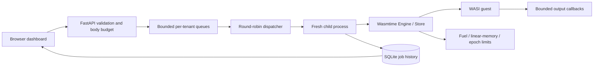

# Architecture

Compilation is serial within each job. The bounded worker slots control concurrency; small guest modules do not create additional parallel compiler pools. The host records a bounded stderr diagnostic if a child exits unexpectedly.

The control plane validates the complete job specification before admission. It resolves catalogue names against a fixed allowlist and never turns a supplied name into an arbitrary filesystem path. HTTP bodies, source, stdin and budgets all have upper bounds.

Each tenant has an independent FIFO. The dispatcher rotates between alpha and beta, permits at most one active job per tenant and never schedules more than two children. Admission returns 429 when either the tenant or global queue fills. Fairness is about dispatch opportunity, not equal CPU shares: jobs have different costs, and there is no preemptive fair CPU scheduler.

Each job starts a fresh Python child, Wasmtime Engine and Store. The Store limits memory, tables and instances, and meters guest execution with fuel. A timer increments the Engine epoch at the requested guest deadline. The parent additionally kills a child after the deadline plus two seconds for startup/compilation. Native module compilation happens before the epoch timer; its overall duration is bounded by the parent, while its memory is not separately capped in native mode.

WASI receives a temporary stdin file and custom output callbacks. Those callbacks store at most the combined byte budget and reject further writes. Guests may handle the resulting I/O error and continue, so fuel and deadlines remain essential. No environment variables are inherited by the guest. No host network functions or WASI HTTP interfaces are linked. An optional synthetic workspace is preopened read-only; no user-selected host directory can be granted.

SQLite persists public result metadata and output. The job source and stdin are not retained in that database. On startup, previously queued/running metadata is marked interrupted, because this scheduler does not replay execution. Completed history is bounded. Job lookup and lists use a parameterized tenant condition; stats expose aggregate counters and only the selected tenant’s recent job data.

## Why a Python host?

The Python binding exposes the same Wasmtime runtime and WASI primitives while making the project executable on a student laptop without a compiler toolchain. The engineering contribution is the admission and dispatch policy, process lifecycle, resource/capability configuration, API behavior, failure classification and measured demonstration. A Rust host is a sensible follow-up experiment, not a prerequisite for real WebAssembly execution.

## References

- [Wasmtime Python binding API](https://bytecodealliance.github.io/wasmtime-py/)
- [Wasmtime security model](https://docs.wasmtime.dev/security.html)
- [WASI specification](https://github.com/WebAssembly/WASI)
